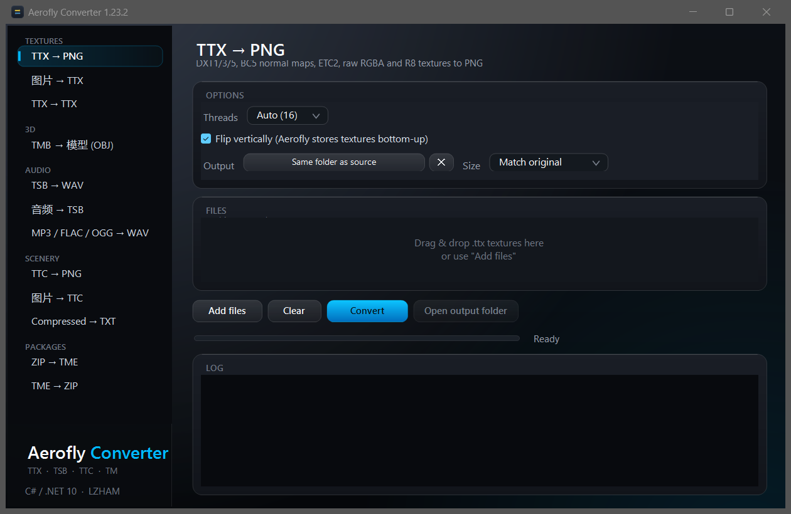
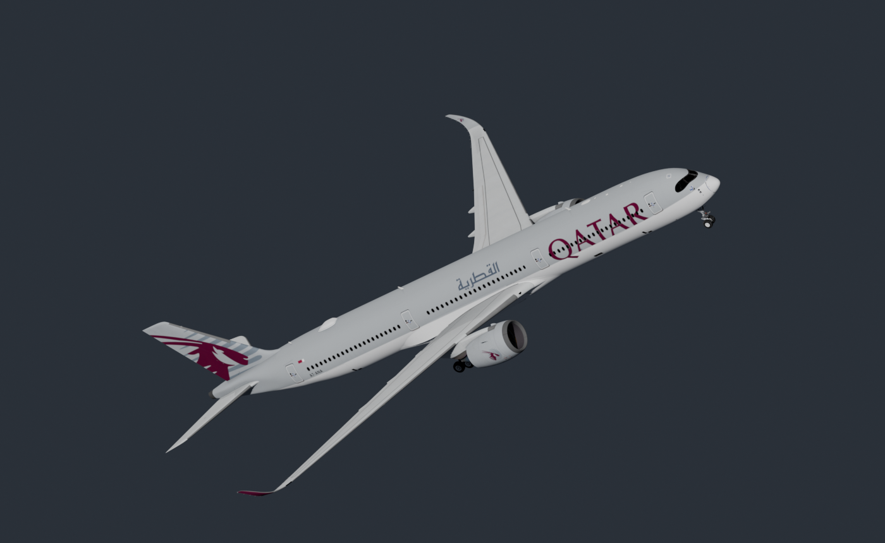

# AeroflyConv — 快得多的 Aerofly FS 转换器（C# / .NET 10）

[`RishiK-06/AeroflyFS-Native-Converter`](https://github.com/RishiK-06/AeroflyFS-Native-Converter) 的 C# 重写版：
功能一一对照，但整条处理管线都是原生代码 —— 纯托管 C# 的 LZHAM 编解码器（**真压缩，8.61×**）、
SIMD 的 BC1/BC3/ETC2 纹理编解码、**ASTC 编解码**（手机版贴图）、自写的高吞吐 PNG 编码器、
多文件并行批处理。



## 为什么快

| 环节 | 原版（Python + PySide6） | 本版（C# / .NET 10） |
|---|---|---|
| LZHAM | `wasmtime` 跑 `tmcompress.wasm`，压缩靠 `pylzham` | 纯 C# 移植的编解码器：解码 99 MB/s、编码 5–7 MB/s（无原生依赖） |
| 纹理解码 | `texture2ddecoder` + 逐像素 Python 循环补 RGBA | 托管 SIMD BC1/BC2/BC3/BC4/BC5/ETC1/ETC2 |
| 纹理编码 | 逐块纯 Python BC1/BC3 | SIMD 块编码器（质量高于原版朴素实现：BC1 40.9 dB vs 38.0 dB） |
| PNG 写出 | Pillow（Generic 管线） | 自写 PNG 编码器 + 逐行自适应滤波 + .NET zlib，快 4–5 倍 |
| 批处理 | 单线程 | `Parallel.ForEach`，默认 = CPU 线程数 |
| 运行环境 | Python 3 + 6 个原生依赖 | 单个自包含 exe，目标机器无需装运行时 |

### 实测（同一批 24 个真实游戏 `.ttx`，共 66.4 MB，4096² / 2048² 混合）

| 场景 | Python 原版 | C# 单线程 | C# 8 线程 |
|---|---|---|---|
| TTX → PNG（24 个文件） | **183.2 s** (0.13 文件/s) | **14.6 s**（12.5×） | **4.7 s**（39×） |
| 单个 4096×4096 DXT1 TTX → PNG | 12–16 s | ≈ 1.0 s | — |
| PNG → TTX（1024² DXT1，含 mip 链 + LZHAM） | 11.1 s | 0.64 s（17×） | — |

LZHAM 本体：解码 **99 MB/s**、编码 **5–7 MB/s**；压缩率 **8.61×**（官方 C++ 参考实现 9.15×），
流格式与发行版逐字段一致（`6E CD` + dict 21 / rate 20），官方 C++、本项目 C# 与
`tmcompress.wasm` 三套解码器结果一致。

---

## 1. 怎么跑

### 免安装（推荐）

```
dist\gui\AeroflyConv.exe          # 图形界面
dist\cli\AeroflyConv.exe --help   # 命令行
```

自包含单文件（GUI ≈ 50 MB / CLI ≈ 37 MB），目标机器不需要 .NET。

### 自己编译

```powershell
cd AeroflyConv
.\build.ps1                       # 输出 .\dist\cli 与 .\dist\gui（win-x64 自包含单文件）
# 若被 PowerShell 执行策略拦住：
powershell -ExecutionPolicy Bypass -File .\build.ps1

dotnet run --project src/AeroflyConv.Gui
dotnet run --project src/AeroflyConv.Cli -- "D:\liveries" -m png2ttx --flip
```

要求 .NET 10 SDK。

---

## 2. 命令行

```powershell
# 按扩展名自动识别（同原版）
AeroflyConv "C:\Aerofly FS 4\aircraft" -j 8

# 纹理
AeroflyConv livery.ttx                        # -> livery.png
AeroflyConv livery.png -m png2ttx --flip      # -> livery.ttx（dxt_auto：有透明用 DXT5，否则 DXT1）
AeroflyConv livery.png -m png2ttx -f dxt1     # dxt1 / dxt5 / type_rgba / type_r / etc2 / type_rgba_etc2

# 场景贴图
AeroflyConv tile.ttc                          # -> tile.png（默认上下翻转）
AeroflyConv tile.png -m png2ttc --ttc-format dxt1

# 声音
AeroflyConv engine.tsb                        # -> engine.wav
AeroflyConv engine.wav                        # -> engine.tsb
AeroflyConv song.flac                         # -> song.wav（也支持 .mp3 / .ogg）

# TM 容器 -> 通用文本树
AeroflyConv airport.tmb                       # -> airport.tmb.txt

# 只看信息
AeroflyConv some.ttx --info
```

参数：`-m/--mode`、`-o/--output`、`-f/--format`、`--ttc-format`、`--flip/--no-flip`、
`--no-mipmaps`、`--no-compress`、`--png-quality fast|balanced|best`、`--zoom N`、
`--no-overwrite`、`-j/--jobs N`、`--info`。

---

## 3. GUI

界面风格参照同机的 `AirportStudioNative`（Direct2D 玻璃拟态）：近黑藏青底色、两道冷白色
径向光晕、1px 白色 10% 描边的半透明卡片、青色 `rgb(0,184,255)` 强调色与绿色成功色，
左侧分类侧边栏 + 选中项青色光条。全部控件自绘（`GlassCard` / `GlassButton` / `GlassSelect` /
`GlowProgressBar` / `NavList`），并启用 WinForms 原生深色模式 + Windows 11 深色标题栏/圆角。

功能：拖放文件或文件夹、按类别分组的模式列表、格式下拉框、线程数、翻转/多级 mip/压缩开关、
进度条、实时日志、"打开输出目录"。

---

## 4. 实现说明

* **LZHAM**（`src/AeroflyConv.Core/Lzham`）：从官方 `lzham_codec` C++ 源码移植的自适应算术
  编解码器（sync/raw/comp/EOF 四种 block、全部符号模型、Huffman 前缀表、匹配查找、raw 回退）。
  解码 99 MB/s、编码 5–7 MB/s；2048² DXT1 贴图 2,796,528 → 324,706 字节（8.61×，官方参考
  实现 9.15×）。产出的流被三套解码器读回一致：官方 C++、本项目 C#、社区工具用的
  `tmcompress.wasm`。
* **纹理编解码**（`Codecs/`）：BC1/BC2/BC3/BC4/BC5 与 ETC1/ETC2/EAC 解码、BC1/BC3、
  ETC2 RGB/RGBA 编码，以及 **ASTC LDR 编解码**（4×4/5×5/6×6/8×8），全部托管实现；解码与
  `texture2ddecoder` 逐字节一致，ASTC 编码产出的块同样两套解码器逐字节一致。
* **容器**（`Tm/`、`Textures/`）：TTX/TTC/TSB/TM 的 chunk 树、mip 链、`compress_file`
  包装、CRC32、tmcompress 头，按原版语义重写（并兼容 IPACS 的 `string8u` 变体）。
* **PNG**：读用 ImageSharp，写用自写编码器（RGB/RGBA、逐行 MSAD 自适应滤波）。
* **音频**：NLayer（MP3）、NVorbis（OGG）、FlacBox（FLAC），全部纯托管。
* **并行**：文件级并行；单文件内部按顺序处理。

> 贴图格式（DXT1 / DXT5 / ETC2 / R8 / BC5 / ASTC）的区别、体积、画质实测和选择建议，
> 见 [`docs/formats.md`](docs/formats.md)。

---

## 5. 验证

`tests/vectors` 里是从**真实游戏文件**生成并与原版 Python 工具对照过的参考数据：

* 24 个真实容器（.ttx / .toc / .tmb / .tsc / .tsl / .wad / .tsb）的 LZHAM 解压结果哈希
* 纹理解码后的 RGBA 哈希（含 DXT1/DXT5/BC5/ETC2）
* TM→文本树的完整文本哈希（含 55 MB 的巨大 .tmb）
* TSB→WAV 字节哈希
* 原版实现（真 `pylzham` 压缩流）编码出的 TTX，用于验证 C# 解码器能吃"真压缩块"
* C# 编码出的 TTX 分别用官方 C++ `lzham_tool`、本项目解码器、以及社区工具用的
  `tmcompress.wasm` 反向验证，解码结果逐字节一致；压缩率与官方参考实现相差 6%

```powershell
dotnet run --project tools/Verify       # 端到端对照（需要 tests/vectors 参考数据）
dotnet run --project tools/LzhamCheck -- <vectorsDir>   # LZHAM 解压向量 + 编码回环 + 吞吐
dotnet run --project tools/LzhamEncCheck -- tests/corpus # LZHAM 编码器差分（官方工具对照）
dotnet run --project tools/AstcEncCheck  # ASTC 编码 PSNR + 双解码器一致性
dotnet run --project tools/CodecCheck   # 块压缩编解码 vs texture2ddecoder / etcpak
```

> `tests/vectors` 未随仓库提交（几十 MB 的真实游戏文件）。重新生成后可跑 `tools/Verify` 与
> 完整的 `tools/LzhamCheck`。

---

## 6. 已知限制（与原版的差异）

* **ASTC**（`type_rgb_astc_*` / `type_rgba_astc_*`，Aerofly 移动版用）可以解码，也可以编码出
  4×4/5×5/6×6/8×8 的 LDR 块（`--format astc6x6` / `astc5x5`）。编码器是单分区、8 位端点实现：
  真实贴图 41–51 dB，通道独立的照片类内容约 29–30 dB（官方 astcenc quality 60 更高，但
  需要多分区搜索）。
* 游戏自带的 `scenery/images/map_*.ttc` 切片（头部格式标记 `0x1234567x`）是未公开的另一种
  变体，原版 Python 工具同样无法读取；本版给出明确提示。转换器自己生成的 TTC 正常工作。
* **BC5 法线贴图**：本版按法线贴图规范重建 Z 通道（正确）；原版总是用零通道推导 Z，
  所以两者蓝色通道不同（红/绿通道逐字节一致）。这是有意修正。
* **ASTC 编码速度**：2048² 贴图标准档约 9 s、快速档 3.4 s（1.21.6 起；1.21 约 30 s），仍比 DXT1 慢一个数量级；
  手机上更慢。只影响 PNG→ASTC，不影响解码与其他格式。
* 输入图片支持 PNG/JPG/BMP/GIF/TGA/WebP（ImageSharp）。

---

## 7. 目录结构

```
src/AeroflyConv.Core/      格式实现：Tm/ Textures/ Codecs/ Lzham/ Media/ Conversion/
src/AeroflyConv.Cli/       命令行入口（输出 AeroflyConv.exe）
src/AeroflyConv.Gui/       WinForms 界面（Ui/ 自绘控件）
tools/LzhamCheck/          LZHAM 自检
tools/CodecCheck/          块压缩自检
tools/Verify/              端到端对照验证
tests/vectors/             参考数据（约 14 MB）
refharness/                生成参考数据的 Python 脚本（需要原版仓库）
docs/screenshot.png        GUI 截图
```

---

## 8. 常见问题：运行一会儿后闪退（NahimicOSD.dll）

Windows 事件日志里如果看到：

```
Faulting application name: AeroflyConv.exe
Faulting module name: NahimicOSD.dll, version: 2.2.25.0
Exception code: 0xc0000005
```

这不是本程序的问题：Dell / Alienware 机器上的 **Alienware Sound Center（Nahimic）** 会把
`NahimicOSD.dll` 注入到每个进程，而这个模块有已知的崩溃缺陷（原生 0xC0000005）。

处理办法（任选其一）：

1. 双击程序目录里的 `NahimicOSD-停止.cmd`（会请求管理员权限），再启动 AeroflyConv；
   需要还原时运行 `NahimicOSD-恢复.cmd`。
2. `services.msc` → 找到 `NahimicService` → 停止，并把启动类型改成「禁用」（永久生效）。
3. 在 Alienware Sound Center / Nahimic 里关闭 OSD / 声音追踪类的叠层功能。
4. 只用命令行版（`dist\cli\AeroflyConv.exe`）批处理，它不开窗口，更不容易被 OSD 碰到。

程序启动时如果检测到该 DLL 已注入，会在日志里给出红色警告并弹窗提示。

---

## 9. 常见问题：`Access to the path ... is denied`

转换结果默认写在源文件旁边。游戏安装目录（`...\SteamLibrary\steamapps\common\Aerofly FS 4 ...`）
一般不允许普通用户写入，所以会报权限错误。三种解决办法：

1. **GUI**：`Options → Output` 选一个可写目录（可写目录里的文件夹结构会按输入镜像），
   右侧 `?` 恢复"写在源文件旁边"。
2. **CLI**：`-d/--outdir`

   ```powershell
   AeroflyConv "E:\SteamLibrary\steamapps\common\Aerofly FS 4 Flight Simulator\aircraft\a350_1000" -d D:\AeroflyPNG -j 16
   ```

3. **什么都不做**：程序会自动改写到 `Documents\AeroflyConv-out`（若也不可写则依次尝试
   `%LOCALAPPDATA%\AeroflyConv\out`、临时目录、exe 同目录 `out\`），日志里会注明实际位置。

另外 "auto" 模式在扫描文件夹时只处理已知的输入扩展名（`.ttx .tsb .wav .mp3 .flac .ogg .ttc
.toc .tsc .wad .tmb .tsl .zip .tme` 和图片），不会再对 `.json`、`.cfg` 之类的文件报"无法识别"。

---

## 10. 贴图方向与"黑色区域"

* **上下颠倒**：Aerofly 的 TTX 贴图按自下而上的顺序存储。导出 PNG 时默认**已经翻转**，
  所以打开就是正立的（GUI 里 `Flip vertically (Aerofly stores textures bottom-up)` 默认勾选，
  命令行可用 `--no-flip` 关闭）。写回 TTX 时也默认翻转，因此"导出→编辑→导入"能对上。
* **某个区域显示为纯黑**：那是 **alpha = 0 的透明像素**，照片查看器会把透明画成黑色
  （A350 的 276 张 RGBA 输出里有 183 张底部带完全透明，属于贴图本身的内容）。
  用 Photoshop / GIMP / 支持透明通道的查看器打开就是透明的。转换日志里现在会提示
  "x% of the pixels are transparent (alpha=0)"。

## 11. 用户目录里的涂装 TTX（原版读不了的那种）

`Documents\Aerofly FS 4\aircraft\...` 里的自制涂装 `.ttx` 用的是另一种外层头：
前 `0x40` 字节与 `0x5A` 异或，外层 magic 为 `a5 a4 24 c7 b7 3c eb b7`。
原版 Python 工具会直接报 "not a TTX texture container"，本版已识别并解出
（解完就是普通的 LZHAM `compress_file` 容器）。实测把整个 `Documents\Aerofly FS 4\aircraft`
目录（含南航 A330 等涂装）25 个文件 3.8 秒转换完成。

---

## 12. 贴图尺寸 / 覆盖原贴图（重要）

游戏里的每个贴图"槽位"都有固定尺寸和格式（A350 机身 `ext01_fuselage_color.ttx` 是
**2048×2048 / DXT1 / 12 级 mip**）。如果写进去的 TTX 尺寸不对（例如 6136×6132、
非 2 次幂、13 级 mip），游戏采样就会错位/加载失败——表现为机身大面积发黑、出现补丁、
看起来"上下颠倒"。

v1.1 自动处理：

* **覆盖已存在的 .ttx 时**：读取该贴图原有的宽高和 GPU 格式，把源图缩放/转成一致的
  （`--no-fit` 可关闭）。
* **目标不存在时**：非 2 次幂的图片自动缩到最近的 2 次幂（如 6136×6132 → 4096×4096）。
* 缩放用面积平均（缩小）/ 双线性（放大），GIMP/PS 之外不需要自己先改尺寸。

实测：把原贴图导出成 PNG 再原样写回，尺寸/格式/mip 数与原文件一致，往返 PSNR 46.8 dB。
（文件体积会比 IPACS 原版大，因为 LZHAM 写的是 raw block，不影响读取。）

### 输出尺寸怎么选

覆盖已有贴图时默认 **Match original**（和原槽位一致，最安全）。想要更清晰可以选更大尺寸：

| 选项 | 结果（源图 6136×6132） | 说明 |
|---|---|---|
| Match original | 2048×2048 / 12 mips，2.7 MB | 与原版槽位完全一致 |
| 4096 px | 4096×4096 / 13 mips，10.7 MB | 比 2048 保留更多细节，推荐 |
| 2048 px | 2048×2048 | 强制降采样 |
| 8192 px | 8192×8192 / 14 mips，42.7 MB | 已超过源图分辨率，只是放大，不增加细节 |
| Source (max PO2) | 4096×4096 | 取不超过源图的 2 次幂 |

命令行：`--size 4096`。显存/加载时间随面积线性增长：40962 约为 20482 的 4 倍，
81922 又是 40962 的 4 倍（DXT1 单张约 11 MB → 43 MB，含 mip）。

---

## 13. 去掉「Windows 已保护你的电脑 / 仍要运行」

这是 SmartScreen 对**未签名程序**的提示。本仓库提供一个一键处理脚本（当前用户证书，不需要管理员）：

```powershell
# 先关闭 AeroflyConv（签名需要写文件）
powershell -NoProfile -ExecutionPolicy Bypass -File tools/sign-app.ps1
# 或在发布目录里双击：签名-去除安全提示.cmd
```

它会：

1. 创建自签代码签名证书 `CN=AeroflyConv Local Publishing`（当前用户，5 年）；
2. 把该证书导入 `当前用户\受信任的根证书颁发机构` 与 `受信任的发布者`；
3. 给所有 `AeroflyConv.exe` 签名（SHA-256）。

之后双击 exe 不再弹"仍要运行"。`build.ps1` 发布会自动调用它（签名证书存在时）。

撤销（删除信任与证书）：

```powershell
certutil -delstore -user Root 583EEC3674E239898741C9809B2EF06E96F7E748
certutil -delstore -user TrustedPublisher 583EEC3674E239898741C9809B2EF06E96F7E748
Remove-Item Cert:\CurrentUser\My\583EEC3674E239898741C9809B2EF06E96F7E748
```

---

## 14. 安卓 / 其他平台

**核心库是可移植的**：`AeroflyConv.Core` 6501 行、零平台 API（没有 System.Drawing / DllImport /
Win32），依赖的 ImageSharp / NLayer / NVorbis 也都是跨平台的。

已经验证的落地方式：

| 方式 | 状态 | 命令 |
|---|---|---|
| Linux / Android(Termux) 命令行 | ? 已构建可用 | `dotnet publish -r linux-arm64 --self-contained` → `dist/AeroflyConv-android-termux-arm64.zip` |
| .NET for Android 原生小 App | 待做（需 Android SDK） | 复用 Core，SAF 文件选择 + 进度 + 保存到 Download |
| MAUI 跨平台 GUI | 待做（需 `maui-android` workload） | 界面需重写 |

在 Android 上用之前要知道的两件事：

1. **存储限制**：Android 11+ 里 `Android/data/<包名>/` 对其他 App（Termux 也算）不可读。
   如果 Aerofly FS Global 的内容在这个目录，必须先 root / Shizuku，或把文件复制到
   `Download` 再用本工具处理。
2. **ASTC**：移动版用 ASTC 贴图，本项目的 ASTC 解码与编码都已实现（4×4/5×5/6×6/8×8），
   不再需要额外的原生依赖。

---

## 15. 安卓 App（实测可用）+ 移动版 ASTC 支持

### 15.1 Android 应用

`src/AeroflyConv.Android` 是一个 .NET for Android 原生应用（不是 MAUI，界面用 XML 布局），
APK 在 `dist/v1.22/android/AeroflyConverter-Alpha-1.22.apk`（minSdk 24 / target 36）；
精简版是 `AeroflyConverter-Public-1.22.apk`（只保留 **图片 → TTX / 音频 → TSB / TTX → TTX**，可与 Alpha 共存）。

安装：`adb install -r AeroflyConverter-Alpha-1.22.apk`，或拷到手机后用文件管理器点击安装。

**界面（全中文，1.21.5 起回到深蓝 + 青色的扁平风格）**：

* 顶部**模式**是横向滑动的药丸分段控件，当前模式的说明文字直接跟在下面；
* **文件**卡片：`添加文件`（可多选）、`文件夹`（递归扫描）、`清空`，逐个文件可点 ✕ 移除，
  底部一行是**输出位置**（`Download/AeroflyConv` 或自选文件夹，点「更改」）；
* **选项**卡片（按模式自动显示）：格式（自动 / DXT1 / DXT5 / ETC2 / R8 / **RGBA 无损** / ASTC 6x6 / ASTC 5x5）、
  贴图尺寸（匹配原尺寸 / 4096 / 2048 / 1024 / 源尺寸）、编码质量（ASTC 专用）、垂直翻转、
  压缩 TTX（LZHAM）、TTC 多级贴图；
* **日志**默认折叠，点标题栏展开（箭头会转），展开状态被记住；转换出现失败时自动展开；
  头部有行数与「复制 / 清空」，每行按级别上色（✓ 成功 / ✕ 失败 / ! 警告 / · 普通）；
* `开始转换` 是渐变胶囊按钮，转换中变成「取消」，下方居中显示进度状态；
* 转换后出现 `打开结果` / `分享`；
* 所有设置存 `SharedPreferences`，下次启动沿用。

也可以在应用私有目录 `Android/data/com.aeroflyconv.app/files/in` 里放文件（方便 adb 批量投放），
用 `am start ... --ez autorun true --es mode png2ttx --es format etc2` 无界面跑批（测试用）。

**实机验证（vivo V2304A / Android 16 / arm64）**：

| 转换 | 结果 |
|---|---|
| TTX (DXT5 1024²) → PNG | 与桌面版**逐像素一致** |
| TTX (BC5 法线 2048²) → PNG | 与桌面版**逐像素一致** |
| TSB → WAV | 与桌面版**逐字节一致** |
| PNG → TTX (DXT1, 256×128, 9 mips) | 与桌面版**逐字节一致** |
| PNG → TTX (ETC2, 512² 与 2048²) | 正常编码，`type_rgb_etc2` |
| 图片 → TTX（PNG / JPG / BMP，1024²） | 三个文件 4.7 s，输出 `type_rgba` mips=11 |
| TTX → TTX（ASTC 6x6 2048² → DXT5） | **5 s**，404,000 B（LZHAM 13.8×） |
| 音频 → TSB（WAV） | 回读采样与源 WAV 完全一致 |

桌面版与手机版共用同一份 `AeroflyConv.Core`，所以行为完全一致（PNG 压缩字节可能因
zlib 实现不同而略有差异，像素不变）。

### 15.2 ASTC（Aerofly FS Global / 手机版贴图）

手机版的贴图是 `type_rgb_astc_6x6` / `type_rgba_astc_5x5`（容器和 LZHAM 与桌面版相同）。
本版新增**纯 C# 的 ASTC LDR 解码器**（`Codecs/AstcCodec.cs`）：

* 支持 4×4 … 12×12 全部块尺寸、1–4 partition、dual-plane、全部 CEM、void-extent、FP16 端点；
* 用手机 DLC 里的 **85 个真实 ASTC 贴图**做回归（`tests/vectors/astc`），与官方解码器
  `texture2ddecoder` **逐字节一致**；
* 桌面吞吐 ≈ **249 MB/s**（2048×2048 6×6 单张 60–130 ms）；
* `tools/AstcCheck` 可单独跑这套回归。

也就是说：**手机版的贴图现在可以在电脑上转成 PNG，也能转回去了**。

### 15.3 ASTC 编码（1.21 新增）

`Codecs/AstcEncoder.cs` 是纯托管 C# 的 ASTC LDR 编码器，`PNG → TTX` 时可直接写出手游用的
ASTC 贴图（CLI `--format astc6x6` / `astc5x5`，GUI 与手机端格式药丸同步新增）：

* 块头严格按 ASTC 规范写：11 位 `block_mode`（枚举全部 2048 个模式后按 `decode_block_mode_2d` 解码、
  再挑权重网格与量化档）、分区数、4 位 CEM、从第 17 位起的 ISE 端点、写在块尾部的（位反转）权重；
* 单分区、8 位端点（CEM8 RGB / CEM12 RGBA），双平面关闭，权重网格在块尺寸内枚举；
* 端点用交替最小二乘拟合，权重用坐标下降取整，评估误差用解码器的精确算式；
* 常数块写成规范的 void-extent（`FC FD FF …` + 4 个小端 UNORM16，无损）；
* 用手机 GPU 做真值验证（Adreno 740：`glCompressedTexImage2D` 上传编码结果、`glReadPixels` 取回对比）：
  4x4 / 5x5 / 6x6 / 8x8 全部 **bad_blocks = 0**，与软件解码 PSNR 67–69 dB（差值只剩 GPU 舍入）；
* 画质：真实贴图 41–51 dB（`callsign_bump` 50.84 dB、`callsign_light` 41.87 dB），
  通道完全独立的照片类内容约 29–30 dB（单分区上限，官方 astcenc 用多分区可达 40 dB+）；
* 速度（1.21.6 规范编码器，含 mip 链与写盘）：2048² 标准档约 **9 s**（快速 3.4 s、高质量 17.6 s），
  512² 约 0.6–1.5 s。

#### 编码质量档位（1.21.2 新增）

ASTC 编码可以在"速度 / 画质"之间选档，CLI 用 `--astc-quality`，手机端在「编码质量」一行选：

```powershell
AeroflyConv livery.png -f astc6x6 --astc-quality fast      # 快速
AeroflyConv livery.png -f astc6x6 --astc-quality standard  # 标准（默认，与 1.21.1 完全一致）
AeroflyConv livery.png -f astc6x6 --astc-quality high      # 高质量
```

实测（2048² 贴图，16 线程，含 mip 链与写盘）：

| 档位 | 耗时 | 输出体积 | 画质 (PSNR) | 做法 |
| --- | --- | --- | --- | --- |
| 快速 fast | **3.4 s** | 41.78 dB | 只精修 3 个配置、1 轮迭代、权重窗口 ±1 |
| 标准 standard | 9.2 s | 41.99 dB | 精修 8 个配置、2 轮迭代、权重窗口 ±2 |
| 高质量 high | 17.6 s | 42.04 dB | 精修 16 个配置、2 轮迭代、权重窗口 ±3 |

（1.21.6 起耗时比 1.21.1 的旧布局慢约 1.6 倍，因为每条候选配置都要按规范重新编码块头并验证模式合法性；
旧布局虽然快，但产出的块硬件不接受，正是 1.21.6 修掉的问题。）

小图差距更小（固定的解码/压缩开销占比大）：512² 快速约 0.6 s、标准 1.0 s、高质量 1.5 s。
手机端默认「标准」，选项会被记住。

### 15.4 更多输入格式、音频打包、TTX 转码（1.22 新增）

**图片输入**（`PNG → TTX` 已更名「图片 → TTX」，`PNG → TTC` 更名「图片 → TTC」）：
PNG、JPG/JPEG、BMP、GIF、TGA、WebP、**PSD**、TIFF、HDR、PBM、QOI 都能直接转，格式按文件内容识别。

**音频输入**：`音频 → TSB` 支持 MP3 / FLAC / OGG / WAV，直接打包成 Aerofly 音效包；
桌面端对应 `-m audio2tsb`。

**TTX → TTX**：在手机上把一张 TTX 解码后再按新格式编码写回，格式、尺寸、mip 链、LZHAM 全部可控；
桌面端对应 `-m ttx2ttx`。同名输入不会覆盖原文件（写成 `*.converted.ttx`）。

**RGBA 无损**：格式药丸新增「RGBA 无损」，输出 `type_rgba`（32 位、不经过块压缩）：

| 输入 | 输出 | 体积 | 耗时（桌面） |
|---|---|---|---|
| 2048² PNG → RGBA 无损 + LZHAM | `type_rgba` 12 mips | 934,616 B | 1.65 s |
| 同上，容器不压缩 | 同上 | 22,369,992 B | 0.43 s |
| 对照：2048² → DXT1 | `type_rgb_s3tc_dxt1` | 324,992 B | 1.34 s |

回读与源图**逐像素一致**（关闭「垂直翻转」时；开启时整体上下翻转，像素本身无损）。

---

## 16. 3D 模型导出（TMB → OBJ / MTL）

Aerofly 的模型文件是 `.tmb`（和贴图一样的 LZHAM 容器，里面是 `tmxglscene` 节点树）。
桌面版可以把任意 `.tmb` —— 飞机、机场、地景物件 —— 直接转成 **OBJ + MTL + PNG 贴图**，
用 Blender / 3ds Max / Maya / SketchUp 打开继续编辑。

`.tmb` 已加入自动识别：直接写文件名就会转成 OBJ，下面的 `-m tmb2obj` 只是显式写法。

```powershell
AeroflyConv a350_1000.tmb
AeroflyConv "E:\SteamLibrary\steamapps\common\Aerofly FS 4 Flight Simulator\aircraft\a350_1000" -m tmb2obj -d D:\models -j 8
AeroflyConv a320.tmb -m tmb2obj --y-up          # Blender / glTF 习惯的 Y 轴向上
AeroflyConv a320.tmb -m tmb2obj --no-textures   # 只要几何，不导出贴图
AeroflyConv a350_1000.tmb --info                # 只看统计：部件 / 三角面 / 材质 / 顶点
```

GUI 里对应侧栏 **3D → TMB → 模型 (OBJ)**。

### 导出结果

| 文件 | 内容 |
|---|---|
| `<名字>.obj` | 每个部件一个 `o` / `g`，带 `v` / `vn` / `vt` 与三角面 |
| `<名字>.mtl` | 每种材质一条，`map_Kd` / `map_Bump` / `map_Ks` / `map_Ke` |
| `<名字>_textures/*.png` | 材质引用的 TTX 自动解码成 PNG（color / normal / specular / reflection / ambient） |
| `<名字>-parts.csv` | 部件清单：部件名、材质名、三角面数、用到的贴图 |
| `<名字>-textures.csv` | 贴图对账表：贴图名、匹配方式（`exact`/`exact+livery`/`suffix`/…）、实际文件 |

### 部件名称

部件名直接取自模型的 `geometry.name`，原样保留、不做「美化」，所以在 Blender 的
大纲视图里就是游戏里的零件名，例如：

```
WingL  WingR  StabilizerVertical  StabilizerHorizontalL  StrobeRear  NoseGearPart3  RNoseWheel
```

只有 OBJ 不允许的字符（空格、括号、中文标点等）会被替换成 `_`；重名自动加 `_2`。
以 A350-1000 为例：**296 个部件 / 246,663 个三角面 / 12 种材质 / 52 张贴图**，
部件清单 `a350_1000-parts.csv` 第一行就是 `"WingL","ext05",5485,"ext05_wingl_color ext05_wingl_ambient ..."`。

### 贴图自动匹配

贴图名来自材质的 `texture_list`（形如 `ext01_fuselage_color`、`ext05_wingl_normal`），
程序按「就近优先」查找：先找模型同目录（含涂装子目录）里的 `.ttx`，再找两级父目录，
并且 **同一个名字优先取离模型最近的那份** —— 否则 `aircraft\` 下几百架飞机的
`ext01_fuselage_color.ttx` 会互相顶掉（早期版本就踩过：A350 被套上了二战运输机的贴图）。

匹配顺序：完全同名 → 后缀匹配（涂装包会加前缀，如 `sa_air_china_ext01_fuselage_color`）→
前缀匹配 → 去掉前缀后的后缀匹配。找不到的贴图会在 MTL 里写成注释
`# map_Kd xxx.ttx (not converted)`，并在日志里给出 `N textures not found`。

**多套涂装只取一套。** 模型目录下常有 `base\`、`b-18311\`、`sa_air_china\` 这样的涂装子目录，
它们带的贴图**名字完全一样**（`fuselage1_color.ttx` 等）。程序会先统计每个子目录能覆盖
多少个被引用的贴图名，选覆盖率最高的那一个作为整套贴图来源，日志打印
`textures: using sa_air_china/ for 42/52 names`，这样机身与机翼不会来自两套涂装。
要指定涂装就加 `--livery <文件夹名>`：

```powershell
AeroflyConv a330.tmb --livery sa_air_china
```

导出的 `<名字>-textures.csv` 会逐条列出「哪张贴图来自哪个文件、用哪种方式匹配」，
出现可疑贴图时先看这张表。

贴图转换会比对源 `.ttx` 与已生成 PNG 的修改时间，源文件更新就重新转换，
不会复用上一次导出的旧图。

### 坐标与朝向

源数据是 **Z 轴向上、X 轴前后**（A350 包围盒 X 73.9 / Y 64.6 / Z 17.2，正好是机长 / 翼展 / 机高），
所以默认原样输出，用 Blender 的 `Forward: Y, Up: Z` 导入即可。加 `--y-up` 会转成 Y 轴向上。
UV 默认不翻转（Aerofly 的模型 UV 已经是 OBJ 约定）；GUI 里的「Flip UV vertically」只给个别反着的模型用。



> 上面这张图是导出的 `a350_1000.obj` 在 Blender 4.5 里直接打开、只用两盏太阳光渲染的结果：
> 涂装、舱门、窗户、发动机、翼尖小翼全部来自模型自带的 UV 与 TTX 贴图。

---

## 17. 版本记录

### 1.23.1

* **修复多涂装贴图串味**：同名贴图改由「覆盖率最高的涂装文件夹」统一提供，新增 `--livery <文件夹>` 强制指定。
* **修复旧 PNG 复用**：源 TTX 比 PNG 新就重新转换，不再沿用早期规则生成的图。
* **修复顶点布局解析**：按 patch 的 `vertex_attrib_size` / `vertex_attrib_offset` 读取，`a330.tmb` 等模型不再数组越界。
* 新增 `<模型>-textures.csv` 对账表（贴图名 / 匹配方式 / 实际文件）。

### 1.23

* **桌面版补齐手机 Alpha 版的全部功能**：图片输入（PSD / TIFF / HDR / BMP / GIF / TGA / WebP / QOI）、
  「音频 → TSB」、 「TTX → TTX」、RGBA 无损输出、ASTC 6x6 / 5x5 编码与三档质量。
* **新增 TMB → 模型（OBJ / MTL / PNG 贴图 / 部件 CSV）**：部件名原样保留、贴图就近匹配。
* GUI 侧栏新增 **3D** 分类与 **TTX → TTX**，纹理模式新增「ASTC 质量」下拉框；不适用的复选框改为隐藏。
* 实测：A350-1000 296 部件 / 246,663 三角面 / 52 张贴图，6 s 出 32 MB OBJ；A320 1562 部件 19 s。

### 1.22

* **手机端输入格式放宽**：图片支持 JPG / BMP / GIF / TGA / WebP / **PSD** / TIFF / HDR / PBM / QOI；
  音频支持 MP3 / FLAC / OGG / WAV。选择器不再按 MIME 过滤，任何文件都能选进来。
* **新增「音频 → TSB」**：MP3 / FLAC / OGG / WAV 直接打包成 Aerofly 音效包（`AudioDecoder` → WAV → `TsbFile`）。
* **新增「TTX → TTX」**：手机端解码后按新格式重编码，支持 DXT1/DXT5/ETC2/R8/RGBA 无损/ASTC，
  可改尺寸并保留 mip 链与 LZHAM 压缩；实测 2048² ASTC 6x6 → DXT5 只花 **5 s**。
* **新增「RGBA 无损」输出**：`type_rgba`（32 位、无块压缩），2048² + LZHAM 为 1.65 s / 934 KB，
  回读与源 PNG 逐像素一致。
* **模式栏去重**：`PNG → TTX` 并入「图片 → TTX」，`WAV → TSB` 并入「音频 → TSB」；
  Public 版只保留 **图片 → TTX / 音频 → TSB / TTX → TTX** 三个模式。
* 与当前模式不匹配的文件不再报错中断，日志显示「跳过 …」。
* 桌面 CLI 同步新增 `-m audio2tsb`、`-m ttx2ttx`，并支持新的图片格式。
* 版本号统一到 **1.22**（Alpha `versionCode 12`、Public `versionCode 9`、桌面 1.22，桌面命名不区分 Alpha/Public）。

### 1.21.6

* **修复 ASTC 贴图进游戏出现黑块 / 棋盘噪声**：旧编码器的块头位布局不符合 ASTC 规范（把 bit 0..1
  当作私有模式位、端点直接写 8 位、常量块用私有形式），而自研解码器用同一套布局去解，所以自测
  "回转 42 dB" 完全正常，交给 GPU 就全乱。新增的真机 GPU 对照工具（`GpuAstcActivity`：把编码结果
  `glCompressedTexImage2D` 上传、`glReadPixels` 取回，与软件解码逐像素比对）复现了这一点：
  修复前 6x6 的 `bad_blocks = 7318 / 7396`，修复后 **0**。
* 编码器按 ARM astcenc 的 `symbolic_to_physical` / `decode_block_mode_2d` 重写：11 位 `block_mode`
  由枚举 2048 个模式选出，端点用 `encode_ise` 纯比特编码，权重按 astcenc 方式位反转写在块尾，
  常量块改用规范 void-extent（`FC FD FF …` + 4 个小端 UNORM16）。公开 API 未变。
* 真机验收（Adreno 740，512² 贴图）：4x4 / 5x5 / 6x6 / 8x8 全部 `bad_blocks = 0`，PSNR 67.4–68.8 dB。
* **修复选 ASTC 格式时闪退**：`SetFormatVisibility` 用固定长度数组索引格式药丸，选中 ASTC（5/6）越界。
* 顺手修掉验证工具的漏洞：GPU 对照 Activity 之前把贴图拉伸到全屏再读角落（读数本身是错的），
  已改为 1:1 视口；`tools/AstcEncCheck` 在 Python 交叉校验不可用时不再打印"通过"。
* 版本号统一到 **1.21.6**（Alpha `versionCode 11`、Public `versionCode 8`、桌面 1.21.6）。

### 1.21.5

* **手机端界面回到 1.2 的样子**：撤掉 1.21.3 / 1.21.4 的玻璃拟态与流动极光背景（`AuroraView.cs`
  已删除），恢复深海军蓝底 `#0B0E14` + 卡片 `#151A22` + 强调色 `#00B8FF`；选中药丸为深青底、
  青色描边、青色文字，与 1.2 一致。
* 开关（垂直翻转 / 压缩 TTX / TTC 多级贴图）补齐选中态配色：轨道打开为 `#00B8FF`、关闭为
  `#252B34`，滑块始终白色；此前两态看不出区别。
* 修复药丸横向滚动过头：切换模式时只滚到"刚好可见"。
* 修复标题与日志里的版本号写死为 `v1.2.0`，改为统一读取 `ProductInfo.Version`。
* 版本号统一到 **1.21.5**（Alpha `versionCode 10`、Public `versionCode 7`）。
### 1.21.4

* **手机端动画背景**：新增 `AuroraView.cs`（纯 Canvas，无第三方库）——6 个彩色光团沿利萨如轨迹
  缓慢游动并用叠加混合，半径会呼吸，色相每 48 秒转一圈；一道光束约 60 秒扫过一圈；两个漂移高光点；
  四周渐晕保证文字对比度。
* 省电处理：仅在可见时绘制（`OnPause` 停 / `OnResume` 续），系统开启"减少动画"时只画静态一帧。
* 玻璃卡片加 `elevation` 投影（8–12dp），层次更清楚。
* 版本号统一到 **1.21.4**（Alpha `versionCode 9`、Public `versionCode 6`）。

### 1.21.3

* **手机端全新界面（iOS"流体玻璃"设计语言）**：页面从 5 张卡片精简为 3 张（文件 / 选项 / 日志），
  模式改成顶部分段控件，输出位置并入文件卡片，日志默认折叠（记住展开状态，失败时自动展开），
  按钮统一成玻璃胶囊，`开始转换` 用渐变胶囊 + 居中状态文字。
* 新增一组玻璃化 drawable（`bg_window` / `bg_glass` / `bg_track` / `bg_pill_on` / `bg_pill_off` /
  `bg_primary` / `bg_ghost` / `bg_ghost_small` / `bg_log` / `bg_file_row`），纯 XML 渐变 + 半透明，
  不依赖 RenderEffect 或第三方库。
* 版本号统一到 **1.21.3**（Alpha `versionCode 8`、Public `versionCode 5`）。

### 1.21.2

* **ASTC 编码质量档位**：新增 `fast` / `standard` / `high` 三档（CLI `--astc-quality`，手机端
  「编码质量」药丸，仅在选择 ASTC 6x6 / 5x5 时出现）。2048² 贴图：快速 **2.5 s** / 41.66 dB，
  标准 5.6 s / 41.95 dB（与 1.21.1 字节一致），高质量 12.0 s / 41.99 dB。
* 版本号统一到 **1.21.2**（Alpha `versionCode 7`、Public `versionCode 4`）。

### 1.21.1

* **ASTC 编码提速 5 倍**：2048² 贴图 31.3 s → **6.0 s**（画质 41.99 dB → 41.95 dB，几乎无损）。
  做法：先给全部配置做廉价打分、只对前 8 名做完整优化；权重层枚举限制在当前位置 ±2 级；
  端点细化与权重更新都加了"超过当前最优即提前退出"的剪枝。
* 版本号统一到 **1.21.1**（Alpha `versionCode 6`、Public `versionCode 3`）。

### 1.21

* **LZHAM 编码器真正实现**（此前写的是 raw block 占位，等于不压缩）：
  2048² DXT1 的 TTX 从 2,796,592 B 降到 **324,992 B（8.61×）**，官方参考实现同数据 9.15×；
  产出流经官方 C++、本项目 C#、`tmcompress.wasm` 三套解码器验证一致。
* **ASTC 编码**落地，手机端 PNG→TTX 可写 ASTC 6x6 / 5x5。
* 桌面与手机版本号统一到 **1.21**；Alpha（`com.aeroflyconv.app`）与 Public
  （`com.aeroflyconv.converter`）可共存。
