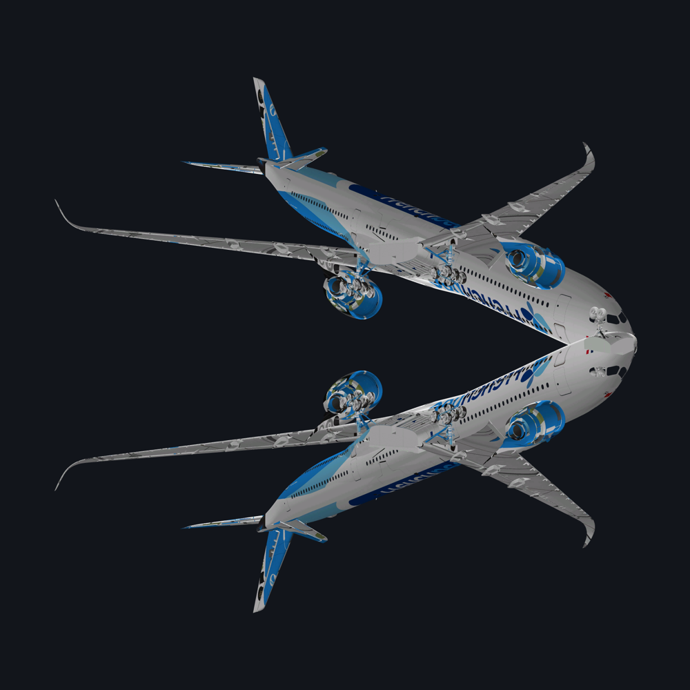

<p align="right"><b>English</b> | <a href="README.zh-CN.md">&#31616;&#20307;&#20013;&#25991;</a></p>

# Horizon Converter

A fast, self-contained converter for Aerofly FS file formats — textures, sounds, scenery containers, text dumps and 3D models — written in C# / .NET 10, for **Windows desktop** and **Android**.

It is a from-scratch reimplementation of [AeroflyFS-Native-Converter](https://github.com/RishiK-06/AeroflyFS-Native-Converter) (Python), roughly **39× faster** on batch texture work, with no Python, no `wasmtime`, and no native dependencies at runtime.

---

## What it does

| You have | You get | Notes |
| --- | --- | --- |
| `.ttx` texture | `.png` | DXT1/3/5, BC5 normal maps, ETC1/2, ASTC (mobile), RGBA, R8 |
| PNG / JPG / BMP / GIF | `.ttx` | DXT1, DXT5, ETC2, R8, RGBA lossless, ASTC 4x4/5x5/6x6/8x8 |
| `.ttx` | `.ttx` | re-encode on the fly (format / size / compression) |
| `.tsb` sound pack | `.wav` | one WAV per chunk |
| WAV / MP3 / OGG | `.tsb` | PCM sound pack |
| WAV / MP3 / OGG | `.wav` | normalised to PCM |
| `.toc` `.tsc` `.wad` `.tmb` `.tsl` | `.txt` | readable text dump |
| `.ttc` scenery texture | `.png` | level-0 image |
| PNG / JPG / BMP | `.ttc` | with full mip chain |
| `.tmb` 3D model | `.obj` + `.mtl` + PNG textures | **every part keeps its name**, textures matched automatically |
| `.zip` / `.tme` | each other | package unpack / repack |

`.ttx` files are read in every container flavour found in the wild: plain, `tmcompress`-compressed (LZHAM) and the XOR-obfuscated variant used by user-folder liveries.

## Why it is fast

| Stage | Original (Python) | Horizon Converter |
| --- | --- | --- |
| LZHAM | `wasmtime` + `pylzham` | pure C# port: **99 MB/s decode, 5–7 MB/s encode**, 8.61× ratio (official 9.15×) |
| Texture decode | `texture2ddecoder` + per-pixel Python | managed SIMD BC1/2/3/4/5, ETC1/2, ASTC |
| Texture encode | per-block Python | SIMD block encoders (BC1 40.9 dB vs 38.0 dB naive) |
| PNG writing | Pillow | own encoder, per-row adaptive filters + .NET zlib |
| Batching | single thread | `Parallel.ForEach`, all cores |
| Runtime | Python 3 + 6 native packages | one self-contained executable |

Measured on the same 24 real game textures (66.4 MB, 4096² / 2048² mixed):

| Scenario | Python | C# 1 thread | C# 8 threads |
| --- | --- | --- | --- |
| TTX → PNG, 24 files | 183.2 s | 14.6 s (12.5×) | **4.7 s (39×)** |
| one 4096² DXT1 TTX → PNG | 12–16 s | ≈ 1.0 s | — |
| PNG → TTX, 1024² DXT1 with mips + LZHAM | 11.1 s | 0.64 s (17×) | — |

## Download and run

Grab a build from the releases page:

- `HorizonConverter-<version>-win-gui.exe` — double-click, nothing to install.
- `HorizonConverter-<version>-win-cli.exe` — command line.
- `HorizonConverter-<version>.apk` — Android 7.0+ (arm64), same converter core as the desktop build.

Both executables are single files with the .NET runtime embedded (~37 MB / ~50 MB). If Windows shows *"Windows protected your PC"*, this build has no commercial certificate — choose **More info → Run anyway**, and compare the file against `SHA256SUMS.txt` if you want certainty.

## Desktop GUI


Ten modes in the sidebar; drag & drop files or whole folders. Options follow the selected mode (format, texture size, ASTC quality, Y-up, Substance-friendly textures…). Output defaults to the source folder; when that is read-only it falls back to `Documents\HorizonConverter-out`, `%LOCALAPPDATA%`, temp, or next to the exe.

Keyboard: `Ctrl+O` add files, `Ctrl+Enter` convert, `Del` clear, `Ctrl+Shift+O` open the output folder.

## Command line

```
HorizonConverter <file-or-folder> [-m mode] [-f format] [-o out]
                 [-d outdir] [--size N] [--astc-quality fast|standard|high]
                 [--flip|--no-flip] [--no-compress] [--jobs N] [--info]
```

Common modes: `ttx2png`, `image2ttx` (alias `png2ttx`), `ttx2ttx`, `tsb2wav`, `audio2tsb`, `audio2wav`, `tm2txt`, `ttc2png`, `image2ttc`, `tmb2obj`. Run `HorizonConverter --help` for everything, including the `zip2tme` / `tme2zip` package modes.

```bat
:: a whole folder of textures -> PNG, 8 threads, mirrored output tree
HorizonConverter "E:\Aerofly FS 4\aircraft\a350_1000" -m ttx2png -d out -j 8

:: livery PNG -> DXT5 with a full mip chain, LZHAM-compressed
HorizonConverter livery.png -m image2ttx -f dxt5

:: mobile texture: ASTC 6x6, high quality
HorizonConverter livery.png -m image2ttx -f astc6x6 --astc-quality high

:: 3D model with named parts and textures
HorizonConverter a350_1000.tmb -m tmb2obj
```

`--info` reports what a file contains without converting anything (texture format, mip count, model part count…).

## 3D model export (TMB → OBJ)

```
a350_1000.obj              geometry, one `o`/`g` per part, `usemtl` per surface
a350_1000.mtl              material library (map_Kd / map_Bump / map_Ks / map_Ke / map_d)
a350_1000-parts.csv        part name, material, triangle count, texture list
a350_1000-textures.csv     which file every texture came from, and how it matched
a350_1000_textures/        every referenced texture converted to PNG
```

- **Part names are preserved** (`WingL`, `StabilizerVertical`, `StrobeRear`, `Spoiler6R`, `MainGearBrakeHose5Lb`…); duplicates get a `_2` suffix.
- Textures are matched by name against the model folder and then its parents. When several liveries sit side by side (`base/`, `qatar/`, `sa_air_china/`…), the folder covering the most referenced names wins, so one model never mixes two liveries. Force one with `--livery qatar`.
- Extra flags: `--y-up` (Blender / glTF coordinates), `--no-uv-flip`, `--no-textures`, `--sp`.
- Source data is Z-up with X as the longitudinal axis, which is what OBJ consumers expect here; `--y-up` converts to Y-up.

**For Substance Painter**, use `--sp`: textures are written flat next to the OBJ and named after the material — `ext05_basecolor.png`, `ext05_normal.png`, `ext05_specular.png`… which is what SP expects when you drag a texture set in.

### Livery preview (TMB → preview.ttx)

The livery picker in Aerofly shows a thumbnail stored as `preview.ttx` inside the livery folder.
`-m preview` renders the model from the same angle and writes that file for you:

```
HorizonConverter a350_1000.tmb -m preview
```

- Same composition as the stock previews: two copies, the lower one mirrored, transparent background.
- Output is 2048² DXT5 with a full mip chain and LZHAM compression (~290 KB, the stock files are ~380 KB).
- Textures come from the livery folder that covers most of the referenced names, so fuselage and wings never mix two liveries.
- Camera: `--preview-yaw` (default 62°), `--preview-pitch` (default 14°), `--preview-size`, `--preview-ss` (supersampling, default 3),
  `--preview-single` for a single aircraft, `--preview-format` to change the layout of the image.
- Takes about 2 seconds for an A350 at 2048²; the renderer is pure C# (no Blender, no GPU).



## Android app

- Package `com.horizonconverter.app`, label **Horizon Converter**, identical converter core.
- All ten modes: TTX→PNG, Image→TTX, TTX→TTX, TSB→WAV, Audio→TSB, Audio→WAV, TM→TXT, TTC→PNG, Image→TTC, TMB→OBJ.
- Files come in through the system picker (SAF); results land in `Download/AeroflyConv` (changeable). Model exports are packed as a zip.
- Fully offline, no network permission. Android 11+ blocks other apps from `Android/data/<package>`, so copy game assets in with a file manager or over USB.

Scripted testing hook:

```bat
adb push livery.png /sdcard/Android/data/com.horizonconverter.app/files/in/
adb shell am start -n com.horizonconverter.app/crc6464a7149c56133886.MainActivity ^
  --ez autorun true --es mode png2ttx --es format astc6x6 --es quality fast
adb pull /sdcard/Android/data/com.horizonconverter.app/files/out/result.txt
```

## Build from source

Requirements: .NET 10 SDK, Windows 10/11 (the desktop image decoder uses GDI+). For the APK: `dotnet workload install android`, a JDK 17+, and the Android SDK.

```powershell
dotnet build AeroflyConv.slnx -c Release

dotnet publish src/AeroflyConv.Cli/AeroflyConv.Cli.csproj -c Release -r win-x64 `
  --self-contained true /p:PublishSingleFile=true /p:IncludeNativeLibrariesForSelfExtract=true `
  /p:EnableCompressionInSingleFile=true /p:DebugType=none -o out/cli
dotnet publish src/AeroflyConv.Gui/AeroflyConv.Gui.csproj -c Release -r win-x64 `
  --self-contained true /p:PublishSingleFile=true /p:IncludeNativeLibrariesForSelfExtract=true `
  /p:EnableCompressionInSingleFile=true /p:DebugType=none -o out/gui

dotnet build src/AeroflyConv.Android/AeroflyConv.Android.csproj -c Release
```

`tools/release.ps1` does build + sign + checksums in one go, and `.github/workflows/release.yml` publishes a GitHub release from a tag. See [RELEASING.md](RELEASING.md).

## Verification

The repo ships self-check tools that compare against independent implementations rather than trusting our own code:

| Tool | Checks |
| --- | --- |
| `tools/LzhamCheck` | decode / encode against the official LZHAM C++ build |
| `tools/AstcCheck` | ASTC decode against `texture2ddecoder` fixtures |
| `tools/AstcEncCheck` | ASTC encode, plus on-device GPU validation |
| `tools/Verify` | end-to-end hashes: TTX→PNG, TSB→WAV, TM→TXT, TTC, round trips |

`tests/vectors` (real game files) is intentionally **not** in the repo. Point the tools at your own Aerofly FS 4 installation to run them.

## Known limitations

- **No FLAC input** since 1.0 (the decoder library had no license). Convert to WAV/MP3/OGG first.
- Image input is decoded by the host: GDI+ on Windows (PNG/JPG/BMP/GIF), `BitmapFactory` on Android. PSD/TIFF/WebP/TGA/HDR are **not** read.
- ASTC encoding is single-partition, single-plane: good quality (≈42 dB at 6x6) but not `astcenc -thorough`.
- Some shipped scenery uses texture containers (`map_*.ttc`, format id `0x1234567x`) that neither the original tool nor this one can decode.
- `.afsenc` (encrypted livery packages) is deliberately unsupported.
- OBJ export writes geometry, UVs and materials; it does not bake lighting or emit glTF (yet).

## License

MIT — see [LICENSE](LICENSE). Third-party components are listed in [THIRD-PARTY-NOTICES.md](THIRD-PARTY-NOTICES.md).

Formats and the original Python tool were reverse-engineered by **Rishi K** ([AeroflyFS-Native-Converter](https://github.com/RishiK-06/AeroflyFS-Native-Converter)); LZHAM is by Rich Geldreich (public domain); ASTC support follows **ARM astc-encoder** (Apache-2.0).

This project ships no Aerofly game assets and is not affiliated with IPACS.
