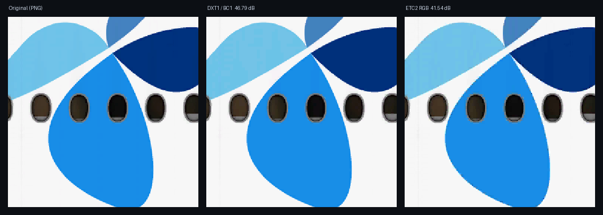

# 贴图格式说明：DXT1 / DXT5 / ETC2 / R8

这份文档解释 Aerofly 贴图（TTX / TTC）里常见的几种像素格式有什么区别、
什么时候该用哪一种，以及在 Aerofly 转换器里怎么选。

---

## 1. 先理解"块压缩"

DXT1、DXT5、ETC2 都属于**块压缩（block compression）**：把图片切成 4×4 像素的
小块，每块压缩成固定长度的字节。好处是显存占用小、GPU 采样快；代价是
**有损**，而且损失是按 4×4 块为单位发生的。

```
一张 2048×2048 的图  →  512×512 = 262,144 个块
DXT1 / ETC2 RGB   每块 8 字节   → 2,097,152 字节（约 2 MB，4 bit/像素）
DXT5 / ETC2 RGBA  每块 16 字节  → 4,194,304 字节（约 4 MB，8 bit/像素）
```

R8 和 RGBA 则**不压缩**，每个像素直接存原始字节。

带上完整的 mip 链（逐级减半，总量约为第 0 级的 4/3），2048×2048 的实际体积：

| 格式 | 每块字节 | 每像素 | 2048² 全 mip 链 | 备注 |
|---|---|---|---|---|
| DXT1 (BC1) | 8 | 4 bit | 2,796,216 B（2.67 MB） | 颜色，1 位"穿透"透明 |
| DXT5 (BC3) | 16 | 8 bit | 5,592,432 B（5.33 MB） | 颜色 + 8 级 alpha |
| ETC2 RGB | 8 | 4 bit | 2,796,216 B（2.67 MB） | 颜色，无 alpha |
| ETC2 RGBA | 16 | 8 bit | 5,592,432 B（5.33 MB） | 颜色 + EAC alpha |
| R8（`type_r`） | — | 8 bit | 5,592,405 B（5.33 MB） | 单通道灰度/遮罩 |
| RGBA（`type_rgba`） | — | 32 bit | 22,369,620 B（21.3 MB） | 完全不压缩 |

> 记忆口诀：**有 alpha 的格式体积是纯颜色格式的两倍**，因为它们多存了一整块
> alpha 数据。R8 看起来"只有一个通道"，但它不压缩，所以反而比 DXT1 大。

---

## 2. DXT1（BC1）

**结构**：每块 8 字节 = 两个 RGB565 端点色（各 2 字节）+ 32 个 2 位索引
（4 字节）。

解码时用两个端点插值出 4 种颜色（端点、1/3、2/3、端点），每个像素用 2 位选择
其中一种。所以**一个 4×4 块最多只能表示 4 种颜色**——这是它所有优缺点的根源。

- **优点**：体积只有原始 RGBA 的 1/8，几乎所有 GPU 都原生支持（1999 年的
  S3TC 标准），解码极快。
- **缺点**：
  - 平滑渐变会出现**色带**（一个块内只有 4 个颜色台阶）。
  - 高对比边缘会有**块状杂色**（端点插值跨过边缘）。
  - alpha 只有"开/关"两种：DXT1 的 1 位 alpha 模式只有 3 种颜色 + 全透明，
    做不了半透明。Aerofly 转换器写 DXT1 时用的是**不透明 4 色模式**。
- **典型用途**：机身、机翼、地景这类**不需要透明**的大面积贴图。

## 3. DXT5（BC3）

**结构**：每块 16 字节 = 8 字节 alpha 块 + 8 字节 DXT1 颜色块。

- alpha 块：两个 8 位端点 + 16 个 3 位索引 → 一个块内 **8 级 alpha**，
  可以做出平滑的半透明渐变。
- 颜色块：和 DXT1 完全一样，所以颜色的画质与 DXT1 相同。

- **优点**：有真正的 alpha 渐变，适合舷窗、玻璃、logo 边缘、蒙皮镂空。
- **缺点**：体积是 DXT1 的两倍；颜色部分的色带问题依旧存在。
- **典型用途**：带透明通道的涂装（livery）、仪表玻璃、螺旋桨模糊盘。

> 同一个 4×4 块里如果既有透明像素又有不透明像素，DXT5 的 alpha 会平滑过渡，
> 而 DXT1 只能二选一——这就是"用 DXT1 存涂装，边缘发黑/发白"的原因。

## 4. ETC2（ETC2 RGB / ETC2 RGBA）

ETC 是 **OpenGL ES 的标准压缩格式**（Android / 移动 GPU 用），ETC2 是它的
第二代，在 GLES 3.0 里是**强制支持**的。

**结构**：

- ETC2 RGB：每块 8 字节，和 DXT1 一样是 4 bit/像素。
- ETC2 RGBA：每块 16 字节 = 8 字节 EAC alpha 块 + 8 字节颜色块。

和 DXT1 的关键区别在"颜色怎么存"：

- ETC1/ETC2 的基础模式把块内像素分成两半，各自用一个**亮度基准 + 亮度修正表**
  （差分模式）来表示，还有一个 3 位的"像素索引表"描述块内的明暗分布。
- ETC2 额外加了 **T 模式 / H 模式 / Planar 模式**：遇到平滑渐变时可以用
  Planar 模式存一个平面方程，比 DXT1 的"4 色插值"更贴合渐变。

- **优点**：移动端通用；对**平滑渐变**的表现通常好于 DXT1（例如天空、柔和
  阴影）；压缩比比 DXT 更"均匀"。
- **缺点**：对**高对比边缘**（文字、细线）不如 DXT1 锐利；桌面显卡大多也能解
  ETC2，但 Aerofly 桌面版本身用的是 DXT，所以 ETC2 主要给移动端用。
- **典型用途**：Android 版 Aerofly 的贴图（不过新版移动端已经改用 ASTC，
  ETC2 主要留给老设备/其他 GLES 引擎）。

实测（同一张 2048² 机身贴图，全 mip，用本转换器编码后再解码对比原图）：

| 格式 | PSNR | 编码耗时（单文件，桌面） |
|---|---|---|
| DXT1 | 46.79 dB | 0.60 s |
| ETC2 RGB | 41.54 dB | 7.00 s |



放大 4 倍看细节：DXT1 在 logo 边缘更锐利但渐变处有台阶；ETC2 渐变更顺，
但细边缘略软。两者都在可接受范围内（PSNR > 40 dB 通常肉眼很难分辨）。

> 注意：本转换器的 ETC2 编码器是逐块搜索的直白实现，比 DXT 编码慢一个数量级，
> 手机上尤其明显。它只影响**编码**（PNG → TTX），解码（TTX → PNG）两边都很快。

## 5. R8（`type_r`）

**结构**：不压缩，每像素 1 字节，只有一个通道。

在 Aerofly 里，`type_r` 常用于**遮罩 / 单通道数据**：着陆灯遮罩、金属度、
粗糙度、自发光强度、alpha 遮罩等。

- **优点**：不压缩、无块状伪影；一个通道的数据可以精确到 1/255。
- **缺点**：只存灰度。从彩色 PNG 转 R8 时，转换器用 BT.601 亮度公式
  `(299R + 587G + 114B) / 1000` 取亮度，**颜色信息会丢失**。
- **体积**：因为没有块压缩，R8 的字节数反而是 DXT1 的**两倍**
  （2048² 全 mip 链 5.33 MB）。
- **典型用途**：任何只需要一个数值通道的贴图。如果你有一张灰度遮罩图，
  用 R8 是正确选择；如果是彩色图，别用 R8。

## 6. 顺带一提：BC5 / ASTC

- **BC5（`type_rg_rgtc2`）**：两个通道（RG）各 8 位块压缩，常用于**法线贴图**。
  蓝色通道（Z）在采样时由 `sqrt(1 - x² - y²)` 重建，所以文件里只存 RG。
  本转换器解码时会重建 Z；与原版 Python 工具对比时只能比 RG 通道（它把蓝色
  通道当 0 处理）。
- **ASTC（`type_rgb_astc_6x6` 等）**：移动端新一代格式，块大小可配置
  （4×4 到 12×12），画质/压缩比都优于 ETC2。Aerofly 手机版用的是
  ASTC 6×6 和 5×5。本转换器**支持解码**（85/85 个真实样本与
  `texture2ddecoder` 逐字节一致），但**不支持 ASTC 编码**——需要写回手机贴图
  时请用 ETC2 或 DXT。

---

## 7. 该怎么选（决策表）

| 你的贴图是…… | 选这个 | 理由 |
|---|---|---|
| 不透明的机身/机翼/地景 | **DXT1** | 体积最小，画质够用，桌面版原生格式 |
| 需要半透明（舷窗、玻璃、镂空） | **DXT5** | 唯一有 8 级 alpha 梯度的 DXT 格式 |
| 手机端贴图（GLES 3） | **ETC2**（RGB 或 RGBA） | 移动 GPU 原生；桌面版读不了 |
| 手机端贴图（新机型） | ASTC | 只能解码，不能编码 |
| 灰度遮罩/单通道数据 | **R8** | 无损单通道，但注意会丢掉颜色 |
| 想完全不损失画质 | **RGBA**（`type_rgba`） | 不压缩，但体积是 DXT1 的 8 倍 |
| 法线贴图 | **BC5** | 只存 RG，Z 由 GPU 重建（本工具可解码） |

在转换器里对应：

```bash
# 桌面版 CLI
AeroflyConv livery.png -m png2ttx -f dxt1      # 不透明
AeroflyConv livery.png -m png2ttx -f dxt5      # 带 alpha
AeroflyConv livery.png -m png2ttx -f etc2      # 移动端
AeroflyConv mask.png   -m png2ttx -f r8        # 单通道遮罩
AeroflyConv livery.png -m png2ttx -f type_rgba # 不压缩
```

- 桌面 GUI：`PNG → TTX` 页的 **Format** 下拉框。
- 手机 App：`PNG → TTX` 模式下的 **格式** 药丸按钮。

**默认值说明**：`自动`（`dxt_auto`）会在图片含透明像素时选 DXT5、否则选 DXT1，
这是最贴合 Aerofly 桌面版惯例的安全选择。如果你覆盖的是游戏里已有的贴图，
转换器默认还会**沿用原文件的尺寸和格式**（见 README 的"贴图尺寸"一节），
避免尺寸/格式与游戏槽位不匹配导致贴图错乱。

---

## 8. 常见疑问

**Q：为什么我把 PNG 转成 DXT1 后，透明边缘变成黑边？**
A：DXT1 的 alpha 只有 1 位，做不到半透明。半透明区域被量化成"全透明"或
"不透明"，边缘就出现黑边。改用 DXT5。

**Q：为什么改成 ETC2 后，游戏里显示不出来？**
A：Aerofly 桌面版（PC）只读 DXT 系格式，ETC2 是给移动端 GLES 用的。
桌面版请用 DXT1/DXT5。

**Q：R8 是不是"低质量灰度"？**
A：不是。R8 是无损的单通道，只是没有颜色。它的体积（每像素 1 字节）比
DXT1（每像素 0.5 字节）大，因为它不做块压缩。

**Q：PSNR 多少算好？**
A：40 dB 以上肉眼基本看不出差别；35–40 dB 仔细看能看到轻微色带；
30 dB 以下块状伪影明显。上面 DXT1 46.8 dB / ETC2 41.5 dB 都属于"很好"。
